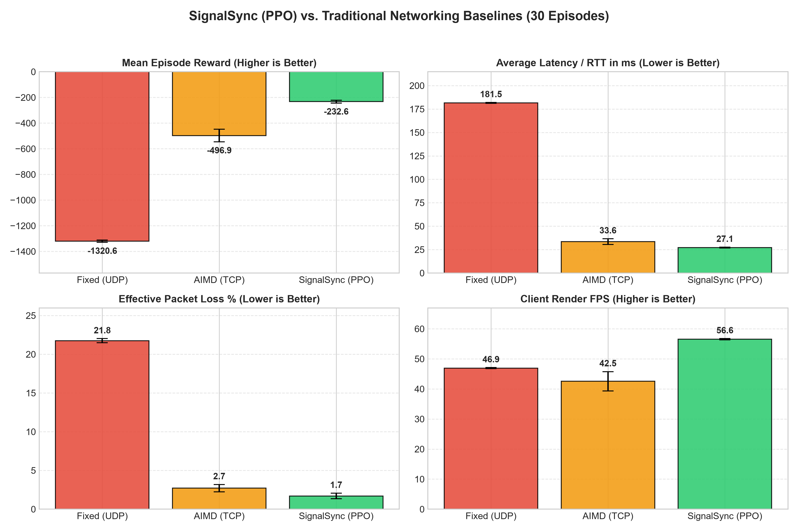
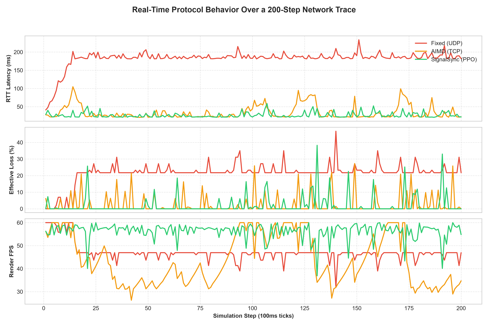
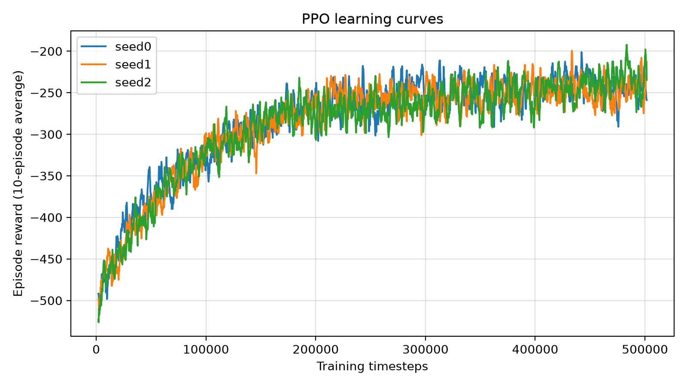

# SignalSync: RL-Based Packet Pacing and FEC Control

A Gymnasium simulator of a lossy, bursty game-traffic link, and a PPO agent that tunes **forward error correction (FEC) redundancy** and **packet pacing** in real time. The agent is benchmarked against a grid-searched constant policy and an AIMD-style heuristic on identical, seeded networks.

<video src="results/signalsync_demo.mp4" autoplay loop muted playsinline width="100%"></video>
*Live dashboard: the PPO controller, the tuned constant policy and an AIMD-style heuristic running on the same simulated link. The Burst button forces a congestion event.*

## Results

All policies run on the **same 100 seeded episodes** (seeds 100-199, 200 steps each). Every policy sees the identical Good/Bad channel sequence for a given seed. Intervals are 95% confidence intervals.

| Policy | Episode reward | Avg RTT (ms) | Effective loss (%) | Render FPS |
|---|---|---|---|---|
| Fixed, naive (FEC 0.15, 4.5 ms) | -1367.2 ± 8.7 | 182.9 | 23.49 | 45.9 |
| Fixed, **tuned** (FEC 0.25, 6.25 ms) | -236.1 ± 7.9 | 28.2 | 2.90 | 58.3 |
| AIMD-style heuristic | -458.5 ± 13.0 | 43.3 | 3.09 | 47.7 |
| **SignalSync (PPO)** | **-224.9 ± 8.6** | 29.4 | 2.71 | 57.8 |

**Paired comparison, PPO minus the tuned constant policy: +11.3 reward (95% CI ±1.1). PPO is better in 97 of 100 episodes.**

How to read this honestly:

- The naive baseline sends about 25.6 packets per tick into a link that drains 20, so it saturates the queue. It is there to show the cost of bad settings, not as a serious competitor.
- The fair comparison is PPO against the tuned constant policy. The gain is real and consistent across episodes, but it is small, about 5% of episode reward.
- The agent's behaviour is interpretable. Averaged over test episodes, it uses about 8% FEC while the channel is in the Good state and about 30% during bursts, while pacing delay moves only slightly (about 5.8 ms to 6.5 ms).







## How it works

### Environment (`network_env.py`)

Each step is a 100 ms tick.

- **Channel:** a Gilbert-Elliott two-state Markov model (Good/Bad). Transition probabilities are 0.05 (Good to Bad) and 0.20 (Bad to Good). Per-packet loss is 1% in Good and 35% in Bad. Per-packet RTT is a 20 ms base plus an exponential tail, which is longer in Bad. These parameters are illustrative, not fitted to real traces.
- **Queue:** a finite fluid FIFO buffer (100 packets) that drains 20 packets per tick, with 2 ms of queueing delay per queued packet.
- **FEC:** parity packets add `fec_ratio` extra load, and recover up to a `fec / (1 + fec)` fraction of the transmitted packets. This recovery is a flat, deterministic model and does not depend on how bursty the losses are (see Limitations).
- **Seeding:** the channel randomness depends only on the episode seed and the tick number, not on how many packets a policy sends. So every policy faces the identical network for a given seed, which is what makes the paired comparison valid.

**Observation** (5 values, scaled before reaching PPO): recent RTT, jitter, effective loss, buffer fill, render FPS.

**Action** (2 continuous values in [-1, 1]): FEC ratio in [0, 0.5] and pacing delay in [3.5, 14] ms.

**Reward** (per step, negated):

```
0.02 * RTT + 0.01 * jitter + 8.0 * loss + 0.08 * (60 - FPS) + 0.8 * FEC_ratio
```

### Training (`train.py`)

PPO from Stable-Baselines3 with a 64x64 MLP, 500,000 steps per seed, three seeds. Observations and rewards are scaled for PPO only. The saved model is the seed with the best score on validation episodes (seeds 2000-2029), which are separate from the test episodes used in the table.

### Baselines (`baselines.py`)

- **Fixed (tuned):** a grid search over constant (FEC, delay) pairs, scored on tuning seeds 1000-1007 that the test episodes never use. The result is cached in `results/tuned_fixed.json` and recomputed automatically if `network_env.py` changes.
- **AIMD-style heuristic:** backs off the pacing delay multiplicatively on loss or a filling buffer, speeds up additively otherwise, and switches FEC level on loss. It is a simplified heuristic, not an implementation of TCP.

## Quick start

```bash
git clone https://github.com/notASIMO/SignalSync.git
cd SignalSync
python -m venv .venv
# Windows: .venv\Scripts\activate    macOS/Linux: source .venv/bin/activate
pip install -r requirements.txt

python -m pytest -q          # environment and seeding tests
python plot_results.py       # benchmark and plots into results/
python web_dashboard.py      # live demo at http://localhost:8050
```

To retrain the agent (about 500k steps per seed; use `--timesteps` and `--seeds` for a quicker run):

```bash
python train.py
python train.py --seeds 0 --timesteps 100000
```

The dependencies are pinned to the versions the model was trained with.

## Repository layout

| File | Purpose |
|---|---|
| `network_env.py` | Gymnasium environment, channel and queue model |
| `baselines.py` | Baseline policies, grid search, evaluation helpers |
| `train.py` | Multi-seed PPO training with validation-based model selection |
| `plot_results.py` | Benchmark table, paired comparison, charts |
| `web_dashboard.py` | Live browser dashboard |
| `simulate_gui.py` | Matplotlib visualizer and GIF recorder |
| `test_env.py` | Tests: API check, finiteness, seeding, pairing, burst persistence, action round-trip |
| `models/`, `results/` | Trained model and generated outputs |

## Limitations

- **Simulator only.** The channel and queue are parameterized models and have not been validated against real network traces.
- **Small effect.** PPO beats the best constant policy by about 5%. The environment gives an adaptive policy limited room to improve.
- **Flat FEC model.** FEC recovery does not depend on how losses cluster inside a block, so the burst model affects the agent less than it would in a real system.
- **Baselines are heuristics.** "AIMD-style" and "Fixed" are simple controllers, not real TCP or UDP, and there is no congestion window or ACK clocking.
- **Single trained agent.** The reported model is the best of three training seeds, selected on validation episodes.

## Contributors

- **Ansh Gupta** ([@anshiitj](https://github.com/anshiitj)): environment rewrite and seeding, baselines, training pipeline, benchmark.
- **Devang Shukla** ([@notASIMO](https://github.com/notASIMO)): dashboards, visualizer, repository and documentation.

Built as a course project at IIT Jodhpur. Released under the MIT License.