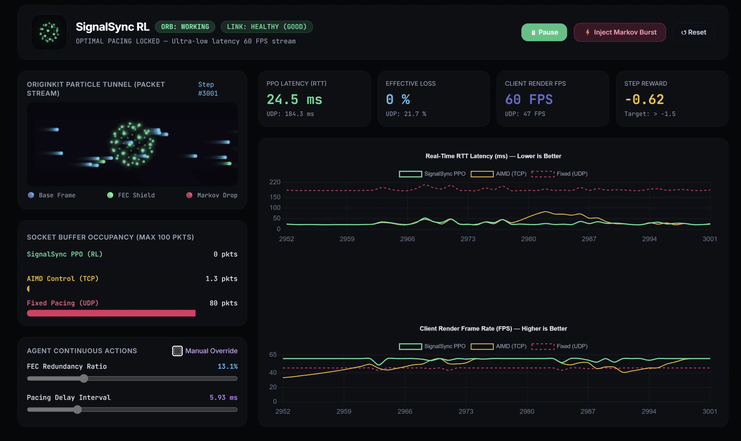

# 🌐 SignalSync RL

**Adaptive Packet Pacing & Congestion Control for Ultra-Low Latency Gaming**

SignalSync is a Reinforcement Learning (RL) based network controller designed to supersede traditional TCP (AIMD) and UDP (Fixed Pacing) protocols in latency-critical environments like real-time multiplayer gaming. By modeling network queue dynamics and link degradation as a continuous-action Markov Decision Process (MDP), our Proximal Policy Optimization (PPO) agent dynamically modulates Forward Error Correction (FEC) and packet pacing to eliminate bufferbloat and packet loss.


*The Originkit-powered live telemetry dashboard demonstrating SignalSync (PPO) preemptively deploying an FEC shield to survive a Markov congestion burst, while TCP experiences severe latency spikes and UDP suffers catastrophic bufferbloat.*

---

## ✨ Key Features

*   **PPO Agent Control:** An RL agent that actively balances queuing delay, jitter, effective packet loss, and client render FPS by manipulating FEC redundancy ratios and pacing delays in real-time.
*   **Gilbert-Elliott Channel Model:** A hidden Markov model simulating realistic, bursty network degradation (Good vs. Bad states) to challenge the agent's recovery mechanics.
*   **Token Bucket Queue Simulation:** Accurately mimics socket buffer dynamics, translating excess pacing into queueing delays (bufferbloat) and tail-drop packet loss.
*   **Live Telemetry Dashboard:** A sleek, interactive web UI built with Originkit UI principles and "Thinking Orbs" visualizations. It pits the PPO agent against traditional TCP (AIMD) and UDP baselines simultaneously.

## 🚀 Installation & Setup

**1. Clone the repository**
```bash
git clone [https://github.com/notASIMO/SignalSync.git](https://github.com/notASIMO/SignalSync.git)
cd SignalSync

```

**2. Install dependencies**

```bash
pip install numpy stable-baselines3 gym Flask

```

*(Note: PyTorch is required for stable-baselines3. See [PyTorch's website](https://pytorch.org/) for your specific system requirements).*

**3. Run the Live Dashboard**
To launch the interactive telemetry environment and evaluate the trained model:

```bash
python web_dashboard.py

```

Open your browser to `http://localhost:8050`.

## 🧠 Environment Formulation (MDP)

* **State Space ($\mathcal{S}$):** RTT Latency, Jitter, Effective Loss Rate, Socket Buffer Occupancy, Client Render FPS.
* **Action Space ($\mathcal{A}$):**
* `FEC Redundancy Ratio`: $[0.0, 0.5]$ (Protects against drop bursts)
* `Pacing Delay Interval`: $[3.5, 14.0]$ ms (Controls socket ingress rate)


* **Reward Function ($\mathcal{R}$):** Heavily penalizes latency spikes, unrecovered packet loss, and frame rate degradation, while slightly penalizing excessive FEC bandwidth overhead.

## 📊 Baselines

SignalSync is benchmarked against two standard network protocol approximations:

1. **Fixed Pacing (UDP):** A static pacing delay with constant FEC. Highly susceptible to bufferbloat during network bursts.
2. **AIMD Control (TCP):** Multiplicatively increases delay upon congestion and additively decreases it during healthy links. Prone to reactive "sawtooth" latency spikes and frame rate stutters.

## 👥 Authors

Developed as an Artificial Intelligence course project at the **Indian Institute of Technology (IIT) Jodhpur** by:

* **Devang Shukla**
* **Ansh Gupta**

---

*Built with Stable-Baselines3 and Python.*
